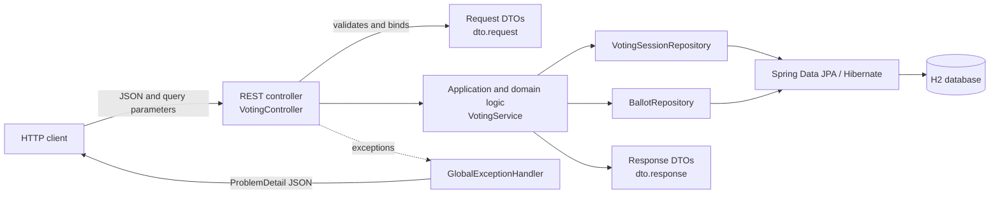
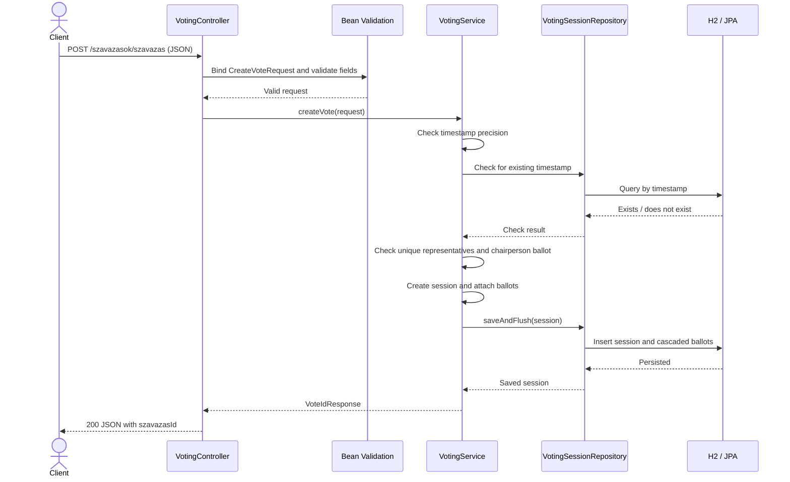
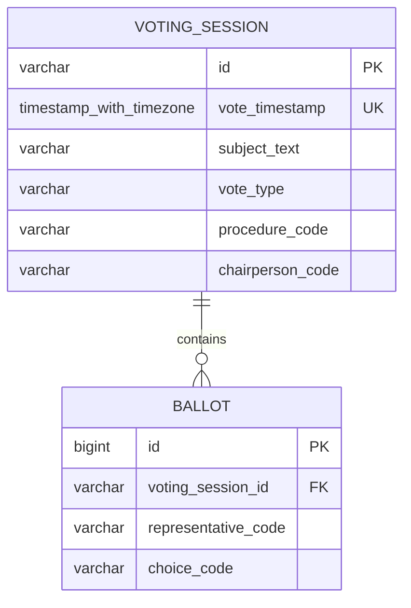

# Voting Service Architecture

## Overview

Voting Service is a Java 21 and Spring Boot 4.1.1 REST API for registering parliamentary voting sessions, recording individual ballots, calculating vote results, and returning participation statistics. The application is a single deployable service backed by a relational database through Spring Data JPA.

## Components

`VotingController` owns HTTP routing and request binding. Bean Validation runs on incoming request DTOs marked with `@Valid`. `VotingService` applies business rules and coordinates repository access. Repositories use Spring Data JPA; Hibernate maps the entities to the schema managed by Liquibase. `GlobalExceptionHandler` converts request, validation, business, and persistence errors to HTTP `ProblemDetail` responses.

## Packages

| Package | Responsibility |
| --- | --- |
| `controller` | REST endpoint mapping and HTTP parameter binding |
| `service` | Vote registration, validation, result calculation, and statistics |
| `repository` | Persistence queries for sessions and ballots |
| `model` | JPA entities: `VotingSessionEntity` and `BallotEntity` |
| `dto.request` | Incoming API data, including ISO timestamp deserialization |
| `dto.response` | Response shapes returned by the API |
| `exception` | Domain exceptions and centralized HTTP error mapping |

## HTTP API

All routes are under `/szavazasok`.

| Method | Path | Purpose |
| --- | --- | --- |
| `POST` | `/szavazas` | Validate and create a voting session and its ballots |
| `GET` | `/szavazat?szavazas={id}&kepviselo={code}` | Read one representative's ballot |
| `GET` | `/eredmeny?szavazas={id}` | Calculate a session's outcome and vote counts |
| `GET` | `/napi-szavazasok?nap={date}` | List sessions for a UTC calendar day |
| `GET` | `/kepviselo-reszvetel-atlag?kezdet={instant}&veg={instant}` | Calculate average participation for a period |
| `GET` | `/kulonleges-eljarasok-szama?kezdet={instant}&veg={instant}` | Count results by special procedure and outcome |

Request and response field names follow the Hungarian API contract (for example, `idopont`, `szavazatok`, and `szavazasId`). Incoming timestamps must be ISO 8601 date-time strings with an explicit timezone offset. Numeric epoch timestamps are rejected.

## Registration flow

Registration creates a canonical 36-character UUID v4 identifier. Session and ballot writes occur in a transaction; ballots cascade from the session. The service validates duplicate timestamps before saving, while database constraints provide a final safeguard against duplicate timestamps and duplicate representatives within one session.

## Persistence model

Liquibase creates the `voting_session` and `ballot` tables. A session has zero or more ballots. The schema enforces a unique session timestamp, a unique `(voting_session_id, representative_code)` pair, and a foreign key from each ballot to its session. Hibernate validates the schema at startup; Liquibase owns schema changes.

## Vote rules and statistics

The API uses compact codes:

| Category | Codes |
| --- | --- |
| Vote type | `j` attendance, `e` simple majority, `m` qualified majority |
| Ballot choice | `i` yes, `n` no, `t` abstention |
| Result | `F` accepted, `U` rejected |
| Special procedure | `s`, `k`, `e` |

- Attendance sessions are accepted and report the number of ballots as the representative count.
- Simple-majority sessions use the ballot count from the latest earlier attendance session. Registration is allowed without a prior attendance session; in that case, `GET /eredmeny` returns `409 Conflict` and the daily response includes the vote with its result and representative count omitted.
- Qualified-majority sessions use the fixed total of 200 representatives.
- Simple and qualified majority pass only when yes votes are strictly more than half of the applicable representative count; ties fail.
- Daily queries use a UTC half-open interval from midnight inclusive to the next midnight exclusive, ordered by timestamp.
- Participation statistics exclude attendance sessions. The total ballot count is divided by 200 and rounded to two decimal places.
- Special-procedure statistics include only procedures `s`, `k`, and `e`; results are counted as accepted or rejected. Simple-majority votes without a prior attendance session are skipped because their result is unavailable. Zero-count rows are returned for each supported procedure, followed by aggregate rows.

## Errors

`GlobalExceptionHandler` maps errors to `application/problem+json` using Spring `ProblemDetail`:

| Cause | HTTP status |
| --- | --- |
| Resource or ballot not found | `404 Not Found` |
| Existing vote whose result cannot be calculated without prior attendance | `409 Conflict` |
| Invalid business rule or Bean Validation failure | `400 Bad Request` |
| Malformed JSON, invalid parameter, or missing required parameter | `400 Bad Request` |
| Database integrity constraint violation | `400 Bad Request` |

Malformed request details include the underlying parser cause when available. Validation errors identify the invalid request field.

## Runtime and configuration

- `application.yml` configures in-memory H2, UTC persistence handling, Liquibase migrations, Hibernate schema validation, and ignoring unknown JSON properties to match the request schema's default behavior.
- `application-docker.yml` configures file-backed H2 at `/data/voting`. Activate the `docker` Spring profile to use it, and mount `/data` as a volume when database persistence across container removal is required.
- The Dockerfile builds the executable JAR with Gradle and runs it on a Java 21 JRE image. The service listens on port `8080` by default.
- Jackson 3 handles JSON mapping; a custom deserializer validates request timestamp strings before converting them to `Instant`.
